# 🤖 Awesome Robotics DevOps (RobOps)

**A curated directory of SaaS platforms, open-source software, observability frameworks, and edge deployment tools for robotics fleets and Physical AI.**

  
  
  
  
  
  
  
  
  

---

## 📖 Introduction & SEO Overview

**Robotics DevOps (RobOps)** bridges continuous integration, fleet telemetry, cloud-to-edge deployment, and operational reliability for autonomous systems. Unlike traditional software DevOps, robotics environments demand resilient data pipelines that handle intermittent connectivity, high-frequency multimodal sensor logs (LiDAR, point clouds, video, IMU), remote teleoperation over WebRTC, mission deconfliction, and deterministic execution on physical hardware.

This repository tracks both leading **enterprise SaaS platforms** and high-velocity **open-source GitHub projects** powering the next generation of Autonomous Mobile Robots (AMRs), Automated Guided Vehicles (AGVs), robotic arms, delivery drones, and autonomous off-highway equipment.

---

## 📑 Table of Contents

- [🌐 Sector Overview & Market Dynamics](#-sector-overview--market-dynamics)
- [☁️ SaaS / Hosted Fleet Management Platforms](#️-saas--hosted-fleet-management-platforms)
- [💻 Open-Source GitHub Projects](#-open-source-github-projects)
- [🏗️ Recommended Architecture Stacks](#️-recommended-architecture-stacks)
- [🤝 How to Contribute](#-how-to-contribute)
- [⚠️ Disclaimer](#️-disclaimer)
- [📈 Star History](#-star-history)
- [💖 Support & Sponsorship](#-support--sponsorship)

---

## 🌐 Sector Overview & Market Dynamics

- **Estimated Market Size**: The global Robot Fleet Management Software and Robot Operations (RobOps) sector is currently valued at approximately **$500M – $700M** and is on pace to exceed **$2.5B by 2030**, advancing at a compound annual growth rate (CAGR) of **~22%–28%**. This surge is catalyzed by multi-robot rollouts across warehouses, logistics fulfillment hubs, smart agriculture, and manufacturing lines.
- **Market Structure & Fragmentation Dynamics**: The RobOps orchestration and observability layer is **moderately to highly fragmented** rather than winner-take-all. Because enterprise facilities deploy heterogeneous fleets (e.g., mixing autonomous forklifts, cleaning bots, inspection quadrupeds, and robotic pickers from different hardware OEMs), single-vendor walled gardens create severe integration bottlenecks. Consequently, the industry strongly favors vendor-agnostic platforms, interoperable standards (like Open RMF and VDA 5050), and transparent data formats (like MCAP), cultivating a vibrant and diverse market for specialized software providers.

---

## ☁️ SaaS / Hosted Fleet Management Platforms

The table below lists leading commercial SaaS and hosted platforms for robotics fleet operations, sorted in descending order by company scale (valuation and capital raised).

| 🏢 Platform / Company | 📊 Scale (Valuation / Funding) | 🛠️ Key Capabilities & Infrastructure | 💰 Starting Tier Pricing | 🎁 Free Tier / Trial Limits |
| :--- | :--- | :--- | :--- | :--- |
| **[Apex.AI](https://www.apex.ai/)** | **~$200M – $250M Valuation** ($75M+ Total Raised; Series B led by Orillion, Continental, ZF, Toyota Ventures, Volvo Group, LG) | Safety-certified real-time robotics & mobility OS (`Apex.Grace` and `Apex.Ida`); ISO 26262 ASIL-D certified ROS 2 runtime; deterministic edge deployment; automotive-grade multi-ECU communications | **$25,000 / year** (Annual commercial developer seat & OEM runtime license) | **30-day evaluation trial** (Full safety SDK access and developer documentation upon qualification & NDA) |
| **[Foxglove](https://foxglove.dev/)** | **~$150M – $200M Valuation** ($58M+ Total Raised; $40M Series B led by Bessemer Venture Partners) | Multimodal temporal visualization workspace; real-time ROS 1/2 WebSocket & bridge connections; native MCAP telemetry recording; 3D point cloud & camera canvas; cloud data indexing & instant playback | **$18 / user / month** (Team Plan starting tier) | **Free Forever Plan**: 10 GB cloud storage, 3 developer users, up to 5 connected devices, 1 active project (Academic: 1 TB free) |
| **[Formant](https://formant.io/)** | **~$120M – $150M Valuation** ($45M Total Raised; $21M Series B led by BMW i Ventures, Intel Capital, SignalFire) | Enterprise robot operations & fleet observability; low-latency WebRTC teleoperation; threshold alerting (PagerDuty, Slack, SMS); automated incident intervention requests; fleet uptime analytics | **$150 / robot / month** (Commercial fleet tier; Base team subscription at $2,000/mo) | **Free Forever Developer Tier**: Up to 2 connected robots, live telemetry streaming, command dispatch, and SSH tunneling (or 14-day enterprise trial) |
| **[Robust AI](https://www.robust.ai/)** | **~$100M – $130M Valuation** ($42.5M Total Raised; $20M Series A-1 led by Prime Movers Lab, JAZZ Ventures, Playground) | Cognitive robotics platform; collaborative mobile warehouse robot (`Carter`) fleet software; dynamic human-robot route coordination; multi-robot facility orchestration | **$2,500 / robot / month** (Robotics-as-a-Service hardware & fleet software bundle) | **30-day simulation trial** (Proof-of-concept digital twin environment for facility layout & cart workflow validation) |
| **[MOV.AI](https://www.mov.ai/)** | **~$35M – $50M Valuation** ($15.6M Total Raised; $8.2M Series B led by BOWE GROUP, State of Mind Ventures, Viola) | Industrial AMR/AGV Robotics Engine Platform; drag-and-drop ROS flow builder; fleet traffic manager; cybersecurity hardening & role-based access for factory automation | **$50 / robot / month** (Annual runtime license starting at $500/robot/year) | **30-day developer trial** (Full ROS navigation, mapping, and simulation evaluation environment for hardware integrators) |
| **[Tartan Sense](https://www.tartansense.com/)** *(Niqo Robotics)* | **~$35M – $50M Valuation** ($22M Total Raised; $13M Series B led by Bidra Innovation Ventures, Fulcrum, Omnivore) | Edge AI computer vision engine; precision spraying autonomous agricultural rover fleet; real-time chemical reduction analytics; offline edge telemetry sync | **$1,200 / machine / month** (Commercial machine tier; seasonal service at ~$15/acre) | **14-day field audit trial** (Up to 50 acres of automated vision analysis and chemical savings audit report) |
| **[InOrbit](https://www.inorbit.ai/)** | **~$30M – $45M Valuation** ($12.7M Total Raised; Series A co-led by L'ATTITUDE Ventures & Globant Ventures) | Cloud-based vendor-agnostic RobOps platform; Adaptive Diagnostics™; real-time map positions; incident management; Time Capsule™ data logging; Space Intelligence AI Copilot | **$30 / robot / month** (Standard Edition usage tier; Developer Edition flat rate at $2,400/yr for up to 8 robots) | **Free Forever Edition**: Unlimited robots for vital observability, Adaptive Diagnostics™, incident Slack alerting, and live map tracking |
| **[Cogniteam Nimbus](https://www.cogniteam.com/)** | **~$20M – $30M Valuation** ($9.8M Total Raised; $5.6M Series A led by Seabarn Management & Panthera) | Cloud robotics AI operating system; drag-and-drop ROS/ROS 2 component library; cloud-in-the-loop simulation; one-click over-the-air (OTA) edge container deployments | **$49 / robot / month** (Nimbus Starter Subscription) | **30-day free trial** (Accessible on `app.cognimbus.com` with in-browser simulation, pre-built ROS modules, and up to 2 connected devices) |
| **[Polymath Robotics](https://www.polymathrobotics.com/)** | **~$15M – $25M Valuation** ($4M Total Raised; YC S22, Samsara Ventures, federal SBIR Phase II awards) | Autonomous vehicle autonomy stack for off-highway industrial machinery; plug-and-play safety layers; radar/LiDAR fusion; path planning; behavior tree coordination | **$500 / vehicle / month** (Autonomy core runtime license) | **14-day sandbox trial** (Virtual proving ground environment with ROS 2 behavior tree tooling and simulation tests) |
| **[Transitive Robotics](https://transitiverobotics.com/)** | **~$3M – $5M Valuation** (Bootstrapped, profitable, $0 venture capital dilution) | Modular full-stack capabilities; low-latency WebRTC video streaming; remote terminal shell; ClickHouse time-series data storage; Grafana dashboards; micro-frontend embedding | **$5 / robot / month** (A la carte starting tier: Terminal $5/mo, File Sync $10/mo, WebRTC $15/mo, Teleop $20/mo) | **Free Forever Plan**: Free core capabilities (Health Monitoring, ROS Tool, Robot Lock, Missions) + **$100 credit for 30 days** on signup |

---

## 💻 Open-Source GitHub Projects

Explore the open-source building blocks of modern robotics infrastructure. The projects below are sorted in **descending order by GitHub Stars_Count**. Beside each repository name is a live Stars_Badge linking directly to that project's stargazers page.

- **[Autoware](https://github.com/autowarefoundation/autoware)**  — The world's leading open-source software stack for autonomous driving mobility, built natively on ROS 2 with complete perception, localization, planning, and control pipelines.
- **[ROS 2 (Robot Operating System 2)](https://github.com/ros2/ros2)**  — The industry-standard open-source robotics middleware framework, delivering real-time determinism, DDS-based communications, cross-platform packaging, and robust hardware abstraction.
- **[Nav2 (Navigation 2)](https://github.com/ros-navigation/navigation2)**  — Production-grade mobile robot navigation and fleet movement stack for ROS 2. Includes dynamic obstacle avoidance, behavior tree task execution, costmap layers, and smooth trajectory controllers.
- **[BehaviorTree.CPP](https://github.com/BehaviorTree/BehaviorTree.CPP)**  — High-performance C++ execution engine for Behavior Trees, widely deployed in robotics mission coordination, autonomous switching, and state management.
- **[Eclipse Zenoh](https://github.com/eclipse-zenoh/zenoh)**  — Ultra-low overhead protocol unifying data in motion, data in use, and data at rest. Delivers microsecond pub/sub, shared memory, and distributed storage across robot edge devices and the cloud.
- **[Fast DDS](https://github.com/eProsima/Fast-DDS)**  — High-performance OMG RTPS/DDS middleware implementation chosen as the default communications backend for ROS 2 distributions.
- **[Awesome Robot Descriptions](https://github.com/robot-descriptions/awesome-robot-descriptions)**  — Curated collection of robot description packages (URDF, MJCF) covering arms, bipeds, quadrupeds, humanoids, and manipulators with license matrices.
- **[Awesome Robotics](https://github.com/ahundt/awesome-robotics)**  — Comprehensive curated index of robotics algorithms, simulator tools, datasets, and foundational literature.
- **[Lichtblick](https://github.com/lichtblick-suite/lichtblick)**  — Open-source visualization and telemetry management platform for robotics development, maintained as a fork of Foxglove Studio by BMW and community contributors.
- **[MCAP](https://github.com/foxglove/mcap)**  — High-performance modular container file format for multimodal robotics data, enabling streaming writes, non-sequential message recovery, and zero-copy indexing.
- **[Open-RMF Demos](https://github.com/open-rmf/rmf_demos)**  — Demonstration environments and full reference architectures showcasing multi-fleet coordination, door/lift automation, and AMR traffic deconfliction.
- **[Open-RMF Core](https://github.com/open-rmf/rmf)**  — Open Robot Management Framework (Open-RMF) core libraries for heterogeneous multi-vendor fleet coordination, traffic deconfliction, and infrastructure dispatch.
- **[Awesome Open Source Robots](https://github.com/stephane-caron/awesome-open-source-robots)**  — Curated index of physical robots with open-source software, mechanical hardware files, and electronics schematics.
- **[action-ros-ci](https://github.com/ros-tooling/action-ros-ci)**  — GitHub Action for building, linting, and running integration test suites on ROS and ROS 2 package repositories inside CI pipelines.
- **[Transitive](https://github.com/transitiverobotics/transitive)**  — Open-source full-stack robotics framework featuring namespaced topic access control, reactive cross-device data synchronization, and integrated ClickHouse / Grafana / Alertmanager observability.
- **[TransAct](https://github.com/transitiverobotics/transact)**  — Open-source robot fleet management dashboard and control center reference implementation with WebRTC teleoperation, terminal access, and heartbeat monitoring.
- **[Isaac Mission Dispatch](https://github.com/nvidia-isaac/isaac_mission_dispatch)**  — NVIDIA cloud service framework implementing the VDA 5050 standard to dispatch missions between enterprise cloud fleet managers and ROS 2 edge robots.
- **[COS Lite Bundle](https://github.com/canonical/cos-lite-bundle)**  — Canonical Observability Stack Lite combining Prometheus, Loki, and Grafana for Ubuntu-based ROS 2 device monitoring, automatic rosbag upload, and edge anomaly alerts.
- **[Trillium](https://github.com/RobotnikAutomation/trillium)**  — Lightweight, open-source web and desktop robotics visualization app based on Foxglove Studio v1.87.0, optimized for low binary footprint and browser-based plugin execution.

> 💡 **Emerging Open Projects**: Keep an eye on **[OpenRobOps (ORO)](https://www.inorbit.ai/)** (InOrbit's upcoming open-source fleet management layer integrated with Open-RMF) and **[NexusOS](https://pypi.org/project/nexusos-robotics/)** (heterogeneous hardware abstraction middleware via async Python HAL plugins).

---

## 🏗️ Recommended Architecture Stacks

For engineering teams building a custom, self-hosted, vendor-agnostic robotics DevOps platform without vendor lock-in, combine these complementary layers:

1. **Edge Middleware & Communications**: [ROS 2](https://github.com/ros2/ros2) + [Eclipse Zenoh](https://github.com/eclipse-zenoh/zenoh) or [Fast DDS](https://github.com/eProsima/Fast-DDS) for low-overhead edge-to-cloud telemetry.
2. **Multi-Fleet Orchestration & Traffic**: [Open-RMF](https://github.com/open-rmf/rmf) + [Isaac Mission Dispatch](https://github.com/nvidia-isaac/isaac_mission_dispatch) using VDA 5050 standards.
3. **Continuous Integration & Testing**: [action-ros-ci](https://github.com/ros-tooling/action-ros-ci) running automated unit tests, code linters, and headless simulation loops in GitHub Actions.
4. **Time-Series Telemetry & Alerting**: [Canonical Observability Stack (COS)](https://github.com/canonical/cos-lite-bundle) with Prometheus, Loki, and Grafana for host health and battery monitoring.
5. **Full-Stack Teleoperation & Logging**: [Transitive](https://github.com/transitiverobotics/transitive) for remote WebRTC driving and [MCAP](https://github.com/foxglove/mcap) for high-density sensor logging.
6. **Visualization & Diagnostic Playback**: [Lichtblick](https://github.com/lichtblick-suite/lichtblick) or [Trillium](https://github.com/RobotnikAutomation/trillium) for 3D point cloud inspections and log scrubbing.

---

## 🤝 How to Contribute

Contributions are warmly welcomed! Help make the robotics DevOps ecosystem transparent and accessible:

1. 🍴 **Fork the repository** on GitHub.
2. 🌿 **Create a new branch** (`git checkout -b feature/add-new-tool`).
3. 📝 **Add or edit entries** in `README.md`:
   - Follow the established table or list format.
   - For SaaS products, include company scale, specific starting tier pricing, and exact free tier/trial limits.
   - For open-source repos, ensure the Stars_Badge format matches: ``.
4. 🚀 **Commit your changes** (`git commit -m "Add ToolName to Robotics DevOps ecosystem"`).
5. 📤 **Push to your branch** and submit a **Pull Request** with a concise description of the tool.

---

## ⚠️ Disclaimer

- This is a community-curated directory intended for research, architectural planning, and educational purposes; inclusion does not constitute an endorsement.
- Robotics DevOps platforms operating physical machinery must adhere to local safety regulations (e.g., ISO 13849, ISO 3691-4, IEC 61508) and comprehensive fail-safe testing prior to live deployment.
- Self-hosted open-source deployments require proper network isolation, VPN tunneling, encryption-at-rest, and ongoing security patching.

---

## 📈 Star History

---

## 💖 Support & Sponsorship

Thank you for visiting **Awesome Robotics DevOps**! 🤖✨

If this curated ecosystem has saved you research hours, helped you architect your robot operations pipeline, or introduced you to your next fleet management tool:

- ⭐ **Star this repository** to help fellow roboticists discover it!
- 🍴 **Fork and share** it with your engineering team and RobOps communities.
- 📢 **Share on LinkedIn, X/Twitter, or Reddit** to spread the word.
- ☕ **Support the maintainer**: If you would like to support the ongoing research, updates, and maintenance of developer ecosystems, please consider sponsoring via the **[GitHub Sponsors Dashboard](https://github.com/sponsors/ishandutta2007)**.

Made with ❤️ for robotics engineers, fleet operators, and developers building the future of physical AI.

